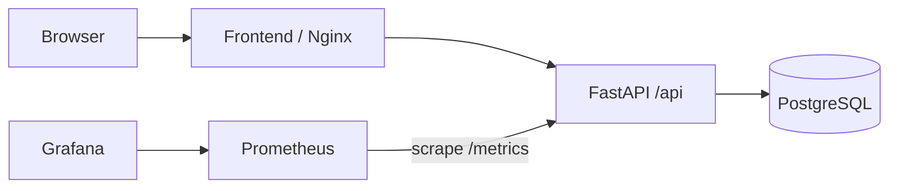

# LabPulse

LabPulse keeps a simple register of shared lab equipment and the problems reported against it. A technician can see which bench is ready, log an incident, move a repair into progress, and resolve it. The equipment state follows its active reports: a high priority fault takes it out of service; a lower priority report marks it for attention.

I chose this domain because a lab needs a visible handoff between classes. The app is small enough to explain during a live demo, while still giving the deployment real data, migrations, tests, and API traffic to monitor.

[Repository](https://github.com/Godatcode/labpulse-devops-capstone) · [Presentation slides](demo/slides.pdf) · [Captioned walkthrough](demo/walkthrough.mp4) · [API documentation](http://localhost:8000/docs) after starting Compose

The [validation record](docs/evidence/validation.md) has command output and screenshots of the app, pipeline, published images, cluster monitoring, and commit history.

## What is in the repo

| Directory | Purpose |
| --- | --- |
| `backend/` | FastAPI, SQLAlchemy models, Alembic migration, isolated API tests |
| `frontend/` | React operations view, built with Vite and served by unprivileged Nginx |
| `helm/labpulse/` | PostgreSQL, two API pods, two web pods, Services, Ingress, HPA |
| `terraform/` | Two-zone VPC and an EKS managed node group |
| `monitoring/` | Prometheus scrape config and a Grafana dashboard |
| `gitops/` | Argo CD Application for the local Kind deployment |
| `demo/` | Presentation slides and captioned walkthrough |
| `.github/workflows/ci.yml` | Tests, frontend build, Docker builds, Trivy gate, SHA-tagged GHCR images |



## Run it locally

You need Docker and Compose. From the repository root:

```bash
docker compose up --build -d
docker compose ps
```

Open [http://localhost:3000](http://localhost:3000). The API is on [http://localhost:8000/docs](http://localhost:8000/docs). Compose loads six equipment records and three incidents for the demo; seeding is repeatable and preserves changes to existing reports. The Compose password is for this local stack only. Set `POSTGRES_PASSWORD` in your environment before using it outside a disposable workstation.

The main routes are:

| Method | Route | Use |
| --- | --- | --- |
| GET | `/health`, `/ready` | Process and database checks |
| GET, POST | `/api/equipment` | Browse and register equipment |
| GET, POST | `/api/incidents` | Browse and report faults |
| PUT, DELETE | `/api/incidents/{id}` | Update or remove a report |
| GET | `/api/summary` | Counts for the overview |
| GET | `/metrics` | Prometheus metrics |

The backend runs Alembic before serving requests. A PostgreSQL advisory lock serializes migrations when both API replicas start together. Container processes run as non-root users.

## Tests and CI

```bash
cd backend
python3.12 -m venv .venv
.venv/bin/pip install -r requirements-dev.txt
.venv/bin/pytest -v
.venv/bin/ruff check .
```

The 10 API tests use a separate in-memory SQLite database. They cover equipment creation, duplicate codes, incident creation and filtering, repair status changes, deletion, and health checks. Every push to `main` runs tests and a production frontend build before building images. Trivy checks OS and library packages in both images and fails on HIGH or CRITICAL findings. If both scans pass, CI publishes `ghcr.io/godatcode/labpulse-backend:<commit-sha>` and `ghcr.io/godatcode/labpulse-frontend:<commit-sha>`.

The public package pages are [backend](https://github.com/Godatcode/labpulse-devops-capstone/pkgs/container/labpulse-backend) and [frontend](https://github.com/Godatcode/labpulse-devops-capstone/pkgs/container/labpulse-frontend). Their tags match the commit shown in the successful Actions run.

## Kubernetes on a local Kind cluster

The local run exercises the same Helm chart without an AWS bill. Install Kind, Helm, kubectl, and Docker first.

```bash
kind create cluster --name labpulse
docker build -t labpulse-backend:local backend
docker build -t labpulse-frontend:local frontend
kind load docker-image labpulse-backend:local labpulse-frontend:local --name labpulse
kubectl apply -f k8s/namespace.yaml
kubectl -n labpulse create secret generic labpulse-db --from-literal=password=labpulse-local-only
helm upgrade --install labpulse helm/labpulse -n labpulse --set ingress.host=localhost --wait
kubectl -n labpulse get pods,svc,ingress,hpa
```

Install an Nginx Ingress controller, then forward it to your machine:

```bash
helm repo add ingress-nginx https://kubernetes.github.io/ingress-nginx
helm upgrade --install ingress-nginx ingress-nginx/ingress-nginx -n ingress-nginx --create-namespace --set controller.service.type=ClusterIP --wait
kubectl -n ingress-nginx port-forward svc/ingress-nginx-controller 8081:80
```

Open [http://localhost:8081](http://localhost:8081). `/api` goes to the backend Service, and `/` goes to the frontend Service. The HPA needs Metrics Server; see [the demo runbook](docs/DEMO.md) for the local Kind installation and verification commands.

After a new commit passes CI, run `bash scripts/deploy-local.sh` to rebuild that revision for the local Kind architecture and roll both Deployments to SHA-tagged images. `KIND_CLUSTER` and `KUBE_CONTEXT` can point the script at another local Kind cluster.

For the GitOps demonstration, [install Argo CD and apply the Application](gitops/README.md). It watches `main` and renders the Helm chart with `values-gitops.yaml`. The local image tags are loaded into Kind; the CI pipeline independently publishes GHCR images for each passing commit. A change to `frontend.replicas` in Git is reflected in the running web Deployment after Argo CD syncs.

## Terraform and AWS

`terraform/` defines a VPC with two public and two private subnets, internet and NAT routing, an EKS control plane, and a two-node managed group. It defaults to `ap-southeast-2`, the Region available to the project account, with two `t3.small` workers. `terraform init` and `terraform validate` passed. An authenticated AWS plan produced `24 to add, 0 to change, 0 to destroy`. Terraform then created all 24 resources. AWS reported the cluster and node group as `ACTIVE`, and `kubectl` showed both nodes `Ready`. The [validation notes](docs/evidence/validation.md) include the live checks and Console screenshots.

After capturing evidence, `terraform destroy` removed all 24 resources. A separate AWS check found no LabPulse EKS cluster, VPC, or Elastic IP; AWS showed the former NAT gateway as `deleted`. Nothing from this Terraform stack should be left running. To repeat the live demonstration, set `admin_cidr` to the current public IP, review the plan and cost, apply, capture evidence, then destroy promptly. EKS, workers, NAT, storage, and data transfer consume AWS credits while running. Do not commit `terraform.tfvars`, state, plan files, or credentials.

## Monitoring

The backend exposes request counts and latency metrics at `/metrics`. The [Prometheus values](monitoring/prometheus-values.yaml) discover and scrape both API pods every 15 seconds. The [Grafana dashboard](monitoring/dashboard-configmap.yaml) shows total requests, requests per minute by route, and p95 latency. Installation and checks are in [the demo runbook](docs/DEMO.md).

## Current limits

LabPulse is a classroom operations demo. It has no login or role checks, and the demo PostgreSQL chart uses a single replica. The local Ingress uses HTTP. Do not place this build on a public campus network without authentication, TLS, and a managed database. The AWS EKS demonstration was short-lived and has been torn down; the runnable application remains available through the documented local Compose and Kind paths.
